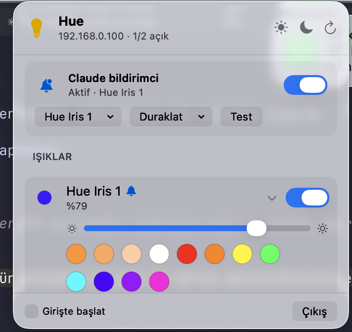

# HueBar

macOS menu bar app for Philips Hue: turn lights and rooms on/off, change brightness and color, and control the [claude-hue-notify](https://github.com/oguzhanT/claude-hue-notify) notifier (pause/resume it and choose its lamp).



Requires macOS 13+ and Swift 5.9+.

```bash
./build-app.sh            # builds build/HueBar.app
./build-app.sh --install  # also copies it to /Applications and launches it
```

The app shares the notifier's config in `~/.config/hue-notify/config.json` (`bridge_ip`, `token`, `light_id`). You can pick several notifier lamps; they're saved as `light_ids`, and `light_id` is kept equal to the first one for older scripts. If that file doesn't exist yet, the app pairs with the bridge itself.

Pausing creates `~/.config/hue-notify/paused`. An empty file pauses until you resume. A unix timestamp pauses until that time. `hue-notify.py` makes no light changes while the pause is active.
